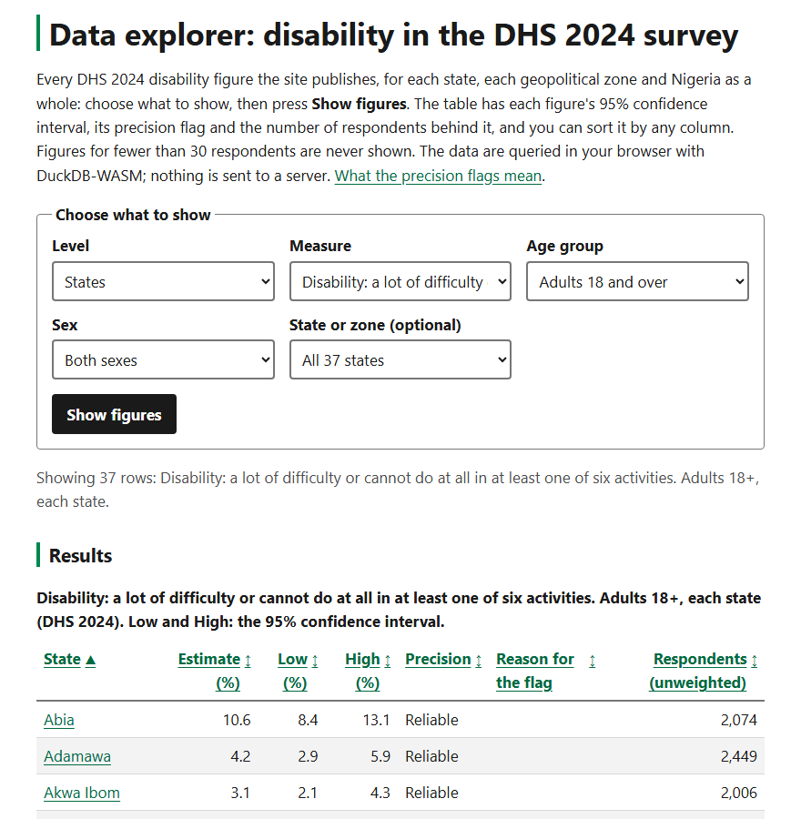
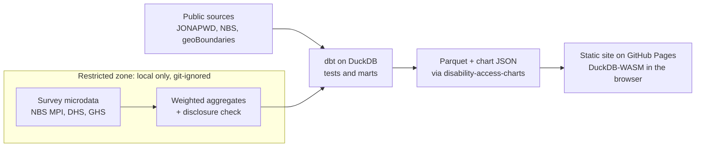

# Curb Cut

[](https://github.com/batestguy/curb-cut/actions/workflows/ci.yml)
[](https://pypi.org/project/disability-access-charts/)
[](LICENSE)

**Nigeria's best-known disability figures are an assumption. Curb Cut is building the measured alternative: state-level survey estimates with honest uncertainty, on a site anyone can use by keyboard or screen reader, at zero cost.**

**[Live site](https://batestguy.github.io/curb-cut/)** · **[Walkthrough video](https://batestguy.github.io/curb-cut/walkthrough.html)** (5:40, captioned; part of it is the NVDA screen reader reading the site) · **[`pip install disability-access-charts`](https://pypi.org/project/disability-access-charts/)**

**What it found**

- **The assumption.** The widely cited figure of about 35 million disabled Nigerians (JONAPWD, 2025) is the projected population multiplied by an assumed 15%; no one was counted ([`docs/verification.md`](docs/verification.md), D66).
- **What the survey measured.** In the Nigeria DHS 2024, 3.0% of adults aged 18 and over (95% confidence interval 2.8% to 3.2%) have a lot of difficulty with, or cannot do, at least one of six everyday activities (the Washington Group cut-off). The official report's broader count, any difficulty at all among people aged 15 and over, is 15.5%. The figures count different things; the site explains each.
- **Disability and poverty.** In a pre-registered analysis of NBS MPI 2021, people in households with a member who has a severe difficulty are 11.7 percentage points (95% CI 6.1 to 17.2) more likely to be multidimensionally poor than people in comparable households: an adjusted association, not proof of cause.

Also: [data explorer](https://batestguy.github.io/curb-cut/explorer.html) · [37 state pages](https://batestguy.github.io/curb-cut/states/) · [data dictionary](https://batestguy.github.io/curb-cut/data-dictionary.html) · [poverty results](https://batestguy.github.io/curb-cut/poverty.html) · [optional API](https://curb-cut-api.onrender.com/docs) ([`docs/api.md`](docs/api.md); free plan, so a request after a quiet spell takes about a minute; the site never depends on it)

## Screenshots

| | |
|---|---|
| [](https://batestguy.github.io/curb-cut/) | [](https://batestguy.github.io/curb-cut/states/kano.html) |
| **The map key filters by keyboard** and says which states it shows. | **A page for each of the 37 states**, with intervals and precision flags. |
| [](https://batestguy.github.io/curb-cut/explorer.html) | [](https://batestguy.github.io/curb-cut/poverty.html) |
| **The data explorer** queries the published files in the browser. | **The pre-registered poverty result**, as an adjusted association. |

Screenshots of the live site's pages, taken 2026-11-08 (light theme; every page also has a dark theme). Each links to its page.

## Start here if you're hiring for…

| Role | Look at |
|---|---|
| Accessibility / frontend | the [live site](https://batestguy.github.io/curb-cut/) by keyboard; the [walkthrough video](https://batestguy.github.io/curb-cut/walkthrough.html) (NVDA reads the site); [the chart library's README](packages/disability-access-charts/); [`site/tests/`](site/tests/) (Playwright + axe) and [`site/lighthouserc.cjs`](site/lighthouserc.cjs) |
| Data / analytics engineering | [`packages/transform/`](packages/transform/) (dbt models and tests); the [two data zones](#how-its-built); the [data dictionary](https://batestguy.github.io/curb-cut/data-dictionary.html) and [explorer](https://batestguy.github.io/curb-cut/explorer.html); [`docs/verification.md`](docs/verification.md), every source checked and dated |
| Data science / statistics | [the methodology page](https://batestguy.github.io/curb-cut/methodology.html) (survey estimates, Fay-Herriot attempt, spatial methods); [the pre-registered poverty analysis](https://batestguy.github.io/curb-cut/poverty.html) ([OSF](https://osf.io/kes3p/)); [the claim checker's interval test](packages/disability-access-charts/docs/claim-checker.md) |
| Python / library design | [`disability-access-charts`](packages/disability-access-charts/) and [the eight steps above](#the-chart-library-in-eight-steps): zero dependencies, typed, tested in CI, trusted publishing to PyPI |
| Policy / communication | [the site](https://batestguy.github.io/curb-cut/)'s plain-language caveats; [`PLAN.md`](PLAN.md) |

## The chart library in eight steps

![An 80-second looping animation in eight captioned steps, each showing the code and its real output: 1, pip install disability-access-charts installs version 0.4.0 with no dependencies; 2, three made-up estimates, each with a 95% confidence interval; 3, dot() returns one JSON document holding the Plotly spec, the description, a data table and an audit; 4, the description, written from the data, says Area A is highest but the survey cannot show a difference from Area B; 5, the audit passes 15 checks, each naming its WCAG success criterion; 6, the sentence "Area A is higher than Area D" gets an empty list, so no problems; 7, "Area A is higher than Area B" is rejected because the difference, 0.70, is not more than 2.27, with the safer wording "the survey cannot show a difference"; 8, the command disability-access-charts check --strict passes the chart. The same steps follow as text.](docs/images/disability-access-charts-tour.gif)

<details>
<summary>The same eight steps as text (copy and run them)</summary>

```bash
pip install disability-access-charts   # step 1: no dependencies
```

```python
from disability_access_charts import ChartData, Series, check_alt_text, dot

# Step 2: each estimate with its 95% confidence interval (made-up numbers).
areas = ["Area A", "Area B", "Area D"]
women = Series("Women", values=(9.8, 9.1, 4.0), lower=(8.1, 7.6, 3.1), upper=(11.5, 10.6, 4.9))

# Step 3: one JSON document per chart.
doc = dot(
    areas,
    [women],
    title="Synthetic prevalence (not real data)",
    value_label="Prevalence (%)",
    category_label="Area",
    source="Synthetic",
    unit="percent",
)
print(list(doc))
# ['id', 'title', 'plotly', 'themes', 'alt_text', 'table', 'data', 'keyboard', 'meta', 'audit']

# Step 4: the description, written from the data.
print(doc["alt_text"])
# Dot plot: Synthetic prevalence (not real data). 3 dots, one per area, each with its
# 95% confidence interval. Highest estimate: Area A, 9.8%, and the survey cannot show a
# difference from the next estimate, Area B, 9.1%. Lowest estimate: Area D, 4.0%, and the
# survey can show a difference from the next estimate, Area B, 9.1%. Intervals (95%
# confidence interval): Area A 8.1% to 11.5%; Area B 7.6% to 10.6%; Area D 3.1% to 4.9%.
# Source: Synthetic.

# Step 5: the audit (every check names its WCAG success criterion).
audit = doc["audit"]
print(audit["passed"], len(audit["checks"]), audit["warnings"])  # True 15 0

# Step 6: a claim the data supports: no problems.
data = ChartData.from_dict(doc["data"])
print(check_alt_text("Area A is higher than Area D.", data))  # []

# Step 7: a claim it cannot support is rejected.
for p in check_alt_text("Area A is higher than Area B.", data):
    print(p.severity + ":", p.reason)
    print("suggestion:", p.suggestion)
# error: the survey cannot show that Area A is higher than Area B: the difference 0.70 is
# not more than 2.27
# suggestion: the survey cannot show a difference
```

Step 8, in CI: audit every chart file (exit code 1 on a failure; with `--strict`, on a warning too). To try it on the chart above, first save it with `import json; json.dump(doc, open("chart.json", "w"))`.

```bash
disability-access-charts check --strict chart.json   # chart.json: passed
```

Every output above, and in the animation, comes from a real run of version 0.4.0 installed from PyPI into a fresh environment (2026-11-08; [`scripts/readme-gif/`](scripts/readme-gif/)).

</details>

## Who's building it

I'm Jerry Bannister, a statistician in Bauchi, Nigeria, and a wheelchair user. A curb cut is the small ramp cut into a kerb: made for wheelchair users like me, and used by everyone pushing a pram or pulling a suitcase. That's the idea behind this project.

I rely on other people's help more than most, and I'd like that help to be easier to give. It starts with knowing who needs it and where. In Nigeria those numbers are mostly assumed, not counted, so Curb Cut puts measured figures in plain view, in charts that work by keyboard and screen reader, not just by mouse. I'm not a screen-reader user myself, so a regular screen-reader user tests the site before launch.

For more than ten years I've turned incomplete Nigerian data into evidence institutions act on: as the statistician behind Abubakar Tafawa Balewa University's federal returns to the NUC, and through my consultancy, JJMB Datascience Hub. MSc Statistics (best in class); PhD in Statistics in progress.

[GitHub](https://github.com/batestguy) · [ORCID](https://orcid.org/0009-0002-3302-9558) · [Google Scholar](https://scholar.google.com/citations?user=oKaejtMAAAAJ)

## Why

JONAPWD's widely cited 2025 figures (about 35 million people) come from applying the global WHO 15% rate to population projections: no one was counted. National surveys did measure it: Nigeria DHS 2024 with the Washington Group Short Set (WG-SS), and NBS MPI 2021 with its own disability items. The NDHS 2024 report already publishes state tables, for women and men aged 15+ separately and without intervals (`docs/verification.md` D46); everything else sits in licensed microdata. Curb Cut turns the microdata into public, disclosure-checked state estimates for both sexes with 95% intervals, puts them next to the assumed figures, and says plainly how sure each number is.

## What's built so far

| | What | Where |
|---|---|---|
| ✅ | **Accessible site:** static, semantic HTML; every chart has a data table and a description built from its data; keyboard-only and screen-reader friendly; DuckDB-WASM queries Parquet in the browser, with no server | [live](https://batestguy.github.io/curb-cut/), [`site/`](site/) |
| ✅ | **`disability-access-charts` 0.4** ([PyPI](https://pypi.org/project/disability-access-charts/)): chart descriptions whose numbers *and comparisons* are checked against the data and its confidence intervals; statistical findings with false-discovery-rate control; adire-inspired pattern fills; an accessible choropleth; descriptions in Hausa, Yoruba, Igbo and Pidgin (AI-drafted, not yet reviewed by native speakers), each checked by its own language's claim checker; a WCAG audit that runs in CI; LLM rewording accepted only if it passes | [`packages/disability-access-charts/`](packages/disability-access-charts/) |
| ✅ | **Ingest and warehouse:** PDF text extraction checked by hand, dbt on DuckDB with data tests, Parquet marts | [`packages/ingest/`](packages/ingest/), [`packages/transform/`](packages/transform/) |
| ✅ | **CI:** ruff, pyright, 1,024 Python tests (coverage gate 85%), dbt build, 239 Playwright + axe tests, Lighthouse accessibility 100 required on 11 pages, deploy to GitHub Pages | [`ci.yml`](.github/workflows/ci.yml) |
| ✅ | **Restricted zone (P3):** licensed microdata stays local; survey-weighted estimates (R `survey`) pass one disclosure gate and an NCHS precision flag before anything is public; reproducible by anyone with their own access | [`packages/ingest/`](packages/ingest/), [`data/public/aggregates/`](data/public/aggregates/), [`docs/reproduce.md`](docs/reproduce.md) |
| ✅ | **Measured prevalence on the site (P4a):** DHS 2024 disability by state with 95% intervals and precision flags, an accessible map and interval chart, a sourced comparison of the 15% and 3% figures, spatial analysis, and a methodology page; small-area (Fay-Herriot) estimation was tried and changes little, so direct estimates lead | [live](https://batestguy.github.io/curb-cut/), [methodology](https://batestguy.github.io/curb-cut/methodology.html) |
| ✅ | **37 state pages (P4b):** plain HTML with no script, each about 50 KB: DHS 2024 with intervals and precision flags, the six activities as a dot plot drawn from a checked chart document, MPI 2021 under its own definition, JONAPWD's assumed figure with its caveat, population, a locator map and the law's national facts; tested with axe, keyboard and an NVDA transcript | [all states](https://batestguy.github.io/curb-cut/states/), [Kano](https://batestguy.github.io/curb-cut/states/kano.html) |
| ✅ | **Disability and poverty (P5):** a pre-registered analysis (OSF, frozen before any poverty figure was split by disability) of NBS MPI 2021: people in households with a member aged 5+ who has a severe difficulty (on MPI's own disability questions, not the WG-SS) are 11.7 percentage points more likely to be multidimensionally poor than people in comparable households (95% interval 6.1 to 17.2; an adjusted association, not a causal effect; DoubleML with sensitivity analysis, refutations and a disclosure-gated release), plus an exploratory GHS-Panel two-round comparison and a two-page policy brief | [results page](https://batestguy.github.io/curb-cut/poverty.html), [pre-registration](https://osf.io/kes3p/) |
| ✅ | **Site polish and tools (P6):** a [data explorer](https://batestguy.github.io/curb-cut/explorer.html) (DuckDB-WASM, keyboard-sortable, the view in the URL); an [assumed rate against the survey](https://batestguy.github.io/curb-cut/sensitivity.html) page; a generated [data dictionary](https://batestguy.github.io/curb-cut/data-dictionary.html) whose build fails if a public column is undescribed; CSV and JSON under every table; a map palette that stays distinguishable under simulated colour-vision deficiency, with a keyboard legend; chart descriptions in four Nigerian languages; a "report a problem" route that needs no account; an optional read-only API; a captioned [walkthrough video](https://batestguy.github.io/curb-cut/walkthrough.html). Checked by keyboard and NVDA at the gate; not yet tested by a regular screen-reader user | [live](https://batestguy.github.io/curb-cut/), [`docs/api.md`](docs/api.md) |

## How it's built



Survey licences forbid publishing household-level data, so microdata never leaves the author's machine, never goes into CI and never goes to an LLM. Only aggregates that pass a disclosure check (any cell with fewer than 30 unweighted respondents is suppressed, plus complementary suppression so that it can't be recovered by subtraction) are public. CI runs the warehouse against synthetic fixtures with the same schema.

## Status

Phases P0–P6 are done (P6 gate passed 2026-11-08); P7 (launch) is in progress. A regular screen-reader user has not yet tested the site; feedback is welcome through the "report a problem" links in every page's footer. See [`docs/STATUS.md`](docs/STATUS.md) for where things stand and [`PLAN.md`](PLAN.md) for the roadmap.

## Methods and data documentation

- [`docs/reproduce.md`](docs/reproduce.md): from licensed microdata to every public aggregate, with software versions.
- [`docs/preregistration.md`](docs/preregistration.md) (frozen at tag `p5-freeze`, registered at https://osf.io/kes3p/) and [`docs/preregistration-deviations.md`](docs/preregistration-deviations.md).
- [`docs/fay-herriot-covariates.md`](docs/fay-herriot-covariates.md): the pre-declared small-area model and why it was not used.
- [`docs/verification.md`](docs/verification.md): every source and check, dated.
- [`data/README.md`](data/README.md) and the README in each `data/public/` folder: contents, definitions, licence and citation.
- [`docs/references.bib`](docs/references.bib): every method and data source cited in these documents.

## How to cite

Cite the software and public aggregates with the metadata in [`CITATION.cff`](CITATION.cff) (GitHub's "Cite this repository" button reads it). The P5 analysis plan is citable separately as its OSF registration, https://osf.io/kes3p/. Please also cite the surveys the figures come from (Nigeria DHS 2024, NBS MPI Survey 2021, GHS-Panel Waves 4 and 5); their citations and terms of use are in each data folder's README.

MIT licensed. Figures are cited from their sources; third-party PDFs are not redistributed.
