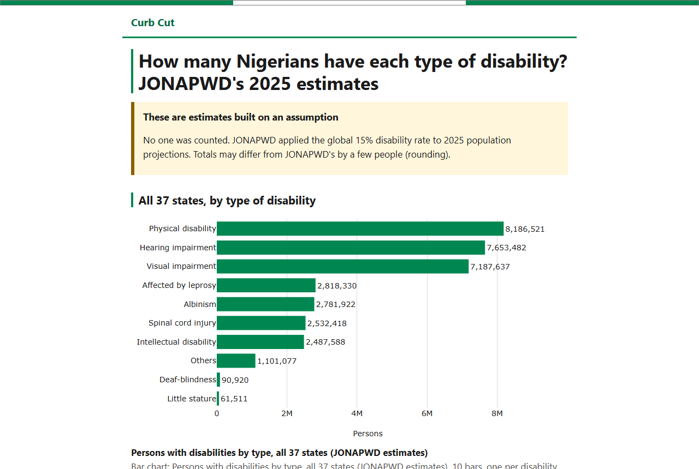
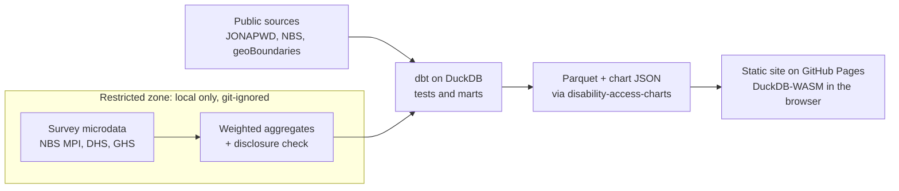

# Curb Cut

**Nigeria's best-known disability figures are an assumption. Curb Cut is building the measured alternative: state-level survey estimates with honest uncertainty, on a site anyone can use by keyboard or screen reader, at zero cost.**

- **Live site:** https://batestguy.github.io/curb-cut/
- **Chart library:** [`disability-access-charts`](packages/disability-access-charts/), charts that check their own words

## Who's building it

I'm Jerry Bannister, a statistician in Bauchi, Nigeria, and a wheelchair user. A curb cut is the small ramp cut into a kerb: made for wheelchair users like me, and used by everyone pushing a pram or pulling a suitcase. That's the idea behind this project.

I rely on other people's help more than most, and I'd like that help to be easier to give. It starts with knowing who needs it and where. In Nigeria those numbers are mostly assumed, not counted, so Curb Cut puts measured figures in plain view, in charts that work by keyboard and screen reader, not just by mouse. I'm not a screen-reader user myself, so a regular screen-reader user tests the site before launch.

For more than ten years I've turned incomplete Nigerian data into evidence institutions act on: as the statistician behind Abubakar Tafawa Balewa University's federal returns to the NUC, and through my consultancy, JJMB Datascience Hub. MSc Statistics (best in class); PhD in Statistics in progress.

[GitHub](https://github.com/batestguy) · [ORCID](https://orcid.org/0009-0002-3302-9558) · [Google Scholar](https://scholar.google.com/citations?user=oKaejtMAAAAJ)

## Why

JONAPWD's widely cited 2025 figures (about 35 million people) come from applying the global WHO 15% rate to population projections: no one was counted. National surveys did measure it: Nigeria DHS 2024 with the Washington Group questions, and NBS MPI 2021 with its own disability items. But their results sit in PDF reports and licensed microdata. Curb Cut turns them into public, disclosure-checked state estimates, puts them next to the assumed figures, and says plainly how sure each number is.

## What's built so far

| | What | Where |
|---|---|---|
| ✅ | **Accessible site:** static, semantic HTML; every chart has a data table and a description built from its data; keyboard-only and screen-reader friendly; DuckDB-WASM queries Parquet in the browser, with no server | [live](https://batestguy.github.io/curb-cut/), [`site/`](site/) |
| ✅ | **`disability-access-charts` 0.1:** chart descriptions whose numbers *and comparisons* are checked against the data and its confidence intervals; a WCAG audit that runs in CI; LLM rewording accepted only if it passes | [`packages/disability-access-charts/`](packages/disability-access-charts/) |
| ✅ | **Ingest and warehouse:** PDF text extraction checked by hand, dbt on DuckDB with data tests, Parquet marts | [`packages/ingest/`](packages/ingest/), [`packages/transform/`](packages/transform/) |
| ✅ | **CI:** ruff, pyright, ~380 tests (90%+ coverage), dbt build, Playwright + axe accessibility tests, deploy to GitHub Pages | [`ci.yml`](.github/workflows/ci.yml) |
| ✅ | **Restricted zone (P3):** licensed microdata stays local; survey-weighted estimates (R `survey`) pass one disclosure gate and an NCHS precision flag before anything is public; reproducible by anyone with their own access | [`packages/ingest/`](packages/ingest/), [`data/public/aggregates/`](data/public/aggregates/), [`docs/reproduce.md`](docs/reproduce.md) |
| ✅ | **Measured prevalence on the site (P4a):** DHS 2024 disability by state with 95% intervals and precision flags, an accessible map and interval chart, a sourced comparison of the 15% and 3% figures, spatial analysis, and a methodology page; small-area (Fay-Herriot) estimation was tried and changes little, so direct estimates lead | [live](https://batestguy.github.io/curb-cut/), [methodology](https://batestguy.github.io/curb-cut/methodology.html) |
| 🔜 | **State pages and `disability-access-charts` 0.2** with map support (P4b) | [`PLAN.md`](PLAN.md) |
| 🔜 | **Disability and poverty:** a pre-registered adjusted association (DoubleML, sensitivity analysis) (P5) | [`PLAN.md`](PLAN.md) |

## Start here if you're hiring for…

| Role | Look at |
|---|---|
| Accessibility / frontend | the [live site](https://batestguy.github.io/curb-cut/) by keyboard; [the chart library's README](packages/disability-access-charts/); [`site/tests/`](site/tests/) (Playwright + axe) |
| Data / analytics engineering | [`packages/transform/`](packages/transform/) (dbt models and tests); the [two data zones](#how-its-built); [`docs/verification.md`](docs/verification.md), every source checked and dated |
| Data science / statistics | [the methodology page](https://batestguy.github.io/curb-cut/methodology.html) (survey estimates, Fay-Herriot attempt, spatial methods); [the claim checker's interval test](packages/disability-access-charts/docs/claim-checker.md) |
| Python / library design | [`disability-access-charts`](packages/disability-access-charts/): zero dependencies, typed, 90%+ test coverage, trusted publishing |
| Policy / communication | [the site](https://batestguy.github.io/curb-cut/)'s plain-language caveats; [`PLAN.md`](PLAN.md) |

## How it's built

Survey licences forbid publishing household-level data, so microdata never leaves the author's machine, never goes into CI and never goes to an LLM. Only aggregates that pass a disclosure check (cells under about 30 respondents suppressed) are public. CI runs the warehouse against synthetic fixtures with the same schema.

## Status

P2 (the chart library 0.1) is built. Next: P3, the restricted data zone and the survey warehouse. See [`docs/STATUS.md`](docs/STATUS.md) for where things stand and [`PLAN.md`](PLAN.md) for the roadmap.

MIT licensed. Figures are cited from their sources; third-party PDFs are not redistributed.
