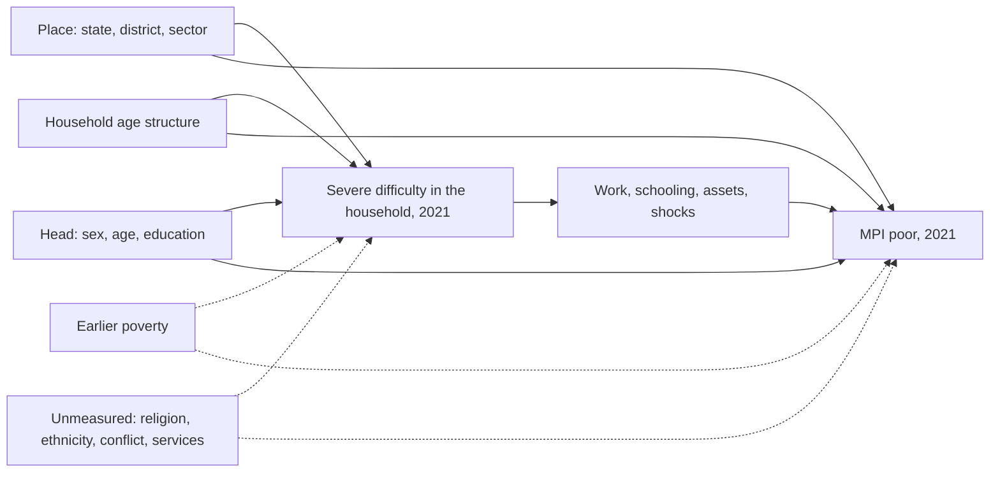

# Pre-registration: disability and multidimensional poverty in Nigeria

**Status: DRAFT (revision 2, after an independent methods review), not yet approved or registered.** When the author approves it, it is committed together with the analysis code, a code-freeze tag is made, and the commit hash, the tag and the SHA-256 of this file, `uv.lock` and `renv.lock` are recorded in section 11. It is then registered on OSF (Secondary Data Preregistration template, Van den Akker et al. 2021). Until the OSF timestamp exists, no individual- or household-level figure linking poverty to disability, or poverty to any confounder, is computed.

- **Project:** Curb Cut (https://github.com/batestguy/curb-cut), phase P5 (`PLAN.md` steps 15–21).
- **Author:** the project author (statistician on this analysis). Code is drafted with an AI assistant (Claude); every decision here is the author's.
- **Date drafted:** 2026-10-30.
- **Registered DHS project:** "Curb Cut: disability prevalence and poverty in Nigeria" (DHS data are not used in this analysis).

Vocabulary: **exposure** means living in a household with a member who has a severe functional difficulty. "Treatment", "ATE" and "IRM" appear only as the names DoubleML gives its code; they do not claim a causal effect.

## 1. Questions

**Primary question (Q1).** In Nigeria in 2021–22, how much more likely are people to live in a multidimensionally poor household when the household includes at least one member aged 5+ with a severe functional difficulty, compared with people in households without one that are comparable on place, age structure and the head's characteristics?

The answer is an **adjusted association** (a standardised difference), not a causal effect (section 7). We expect a positive difference (NBS's unadjusted gap is 9.6 points, D61; the literature finds positive associations), but the test is two-sided.

**Secondary questions** (labelled secondary wherever reported):
- **S1.** The same comparison for the household deprivation score (0–1, uncensored), not the poor/not-poor cut.
- **S2.** Exposure by NBS's broad definition (some difficulty or worse in any item, or a skin condition), as in NBS Table 7.
- **S3.** Exposure = the household head has a severe difficulty.
- **S4.** Where the difference sits: the same comparison for each dimension's weighted deprivation score (health, education, living standards, work and shocks). Descriptive; not a mechanism analysis.
- **S5.** Exposure with people whose seeing, hearing or walking severity was not asked (section 3.2) counted as severe.
- **S6.** A routing-free exposure: a severe difficulty in self-care, remembering or communication only (no screener or aid routing).

**Exploratory questions** (labelled exploratory; intervals only, no "supported" wording):
- **X1.** The primary comparison within urban and rural areas, and within each of the six zones.
- **E1 (GHS-Panel).** Among people with no severe difficulty in 2018/19, is the onset of a severe difficulty by 2023/24 associated with a change in household consumption and in the person's work? (section 8)

## 2. Data

### 2.1 Datasets

- **NBS Multidimensional Poverty Index Survey 2021** (fieldwork 2021–22), National Bureau of Statistics, microdata catalogue entry 71 (`NGA-NBS-MPI-2021-v1.0`). Licensed; used for reporting aggregated information only; a copy of each publication goes to the National Data Archive. 53,415 households in the identification file; 21 files linked on `hh_id`.
- **GHS-Panel Waves 4 (2018/19) and 5 (2023/24)**, NBS and the World Bank LSMS-ISA. Licensed. Representative nationally and by zone only.

Microdata stay in the git-ignored restricted zone. Only estimates that pass the project's disclosure check (no published cell from fewer than 30 unweighted respondents) leave it.

### 2.2 Prior knowledge (disclosure)

Everything the author and the project know that bears on the questions, before this registration:
1. **NBS Table 7** (D61): 71.4% of people in households with a person living with a disability are MPI-poor, against 61.8% without (MPI 0.302 vs 0.252; 11.0% of the population in such households), on NBS's broad definition. Published, unadjusted.
2. **NBS section 3.6 and Figure 14:** in households with a person living with a disability, the share poor and deprived is higher in 10 of the 15 indicators, and the work-and-shocks indicators contribute more to their MPI. This bears directly on S4.
3. **An ecological look at poverty and disability (P4a, D52, D56):** NBS's state MPI headcount (Table D6) was candidate covariate C3 in a Fay-Herriot model of DHS 2024 state disability prevalence. Its fitted coefficient was 0.0107 (p = 0.379; `data/public/sae/fh_model_selection.csv`), and it was not selected. This is a state-level association between two different surveys' figures, not this analysis. The spatial analysis (D58) did not use MPI poverty.
4. **Disability prevalence from MPI 2021** by state and nationally (MPI's own measures; `data/public/aggregates/mpi2021_state_national.csv`), with no poverty split.
5. **DHS 2024 disability by wealth quintile**, published on the site's state pages. A different survey and wealth index; it shows disability prevalence varies across wealth quintiles. Not used here.
6. **The rebuilt national MPI** (step 16, D64): national H, A and MPI and each indicator's national deprivation rate. The first complete validation run failed (H 60.8 against 62.9 ± 1.0). Two education rules were then corrected so that the rebuild reproduces the report's Table 8 (school attendance) and Table 9 (schooling of household members); the second run passed (H 63.0, A 40.7, MPI 0.256). National alternative cooking-fuel definitions were also computed (D64). None of this splits by disability or by any confounder.
7. **GHS:** national and zone disability prevalence for W4 and W5 (published aggregates). No consumption or work figure has been examined, by disability or otherwise.
8. **Metadata only** for every other variable (names, labels, value labels, row and distinct-value counts; D62–D64).

No individual- or household-level analysis linking poverty, deprivation, consumption or work to disability, or to any confounder, has been run by the author or the project.

## 3. Variables (MPI 2021)

### 3.1 Unit, sample and weights

- **Unit:** the household. Every member shares the household's poverty status, as in the national MPI.
- **Sample:** households with a completed interview (`a9a` = 1; 52,022, all with a positive population weight; D64), with at least one member aged 5+ in the disability section. The fewer than 30 weighted households that refused (`a9a` = 6) are excluded.
- **Weights:** the population weight (`pop_wgt`, household weight × household size, state-calibrated; D40), so the estimate is a share of **people**, like NBS's H. The Kish effective sample size and the largest weight's share are reported.
- **Clusters:** the enumeration area `a4`, whose codes are unique nationally (3,556 EAs with weighted households; D64). Some EAs span more than one of D40's assumed strata (state × senatorial district × sector gives 3,604 combinations), so those strata are not used. DoubleML's standard errors use EA clusters without strata (conservative). The design-based benchmark (5.2) uses strata = state, in which every EA is nested.

### 3.2 Exposure (primary)

A household is **exposed** if any member aged 5+ has a severe difficulty: "a lot of difficulty" or "cannot do at all" in at least one of
- self-care (`d11a`), remembering or concentrating (`d12a`), communication (the worse of understanding `d9a` and being understood `d10a`), answered by nearly everyone; or
- seeing, hearing or walking, where MPI asks severity ("even when wearing glasses / using a hearing aid / using equipment") **only if the screener is "yes" and the person uses the aid** (D43).

People with a "yes" screener for seeing, hearing or walking and no aid have **no severity answer**. In the primary definition they count as **not severe** for that domain. Aid use depends on wealth, so this misclassification is **differential**: severely disabled people in poorer households, who are less likely to have an aid, are more likely to sit in the comparison group. The primary estimate is therefore expected to lie towards zero, and the primary and S5 (which counts them as severe) are presented as two bounds. S6 avoids the routing altogether.

Members under 5 are not assessed by MPI. Upper-body items (lifting, hands) are left out of the primary definition, which stays as close to the Washington Group's six domains as MPI allows; they are part of S2.

A household is **unexposed** if every member aged 5+ has non-missing, not-severe answers in every domain above. Households with a member whose answers are all missing are excluded; their number and weighted share are reported.

This is MPI's own measure, not the Washington Group's DISABILITY3, and is described as such everywhere it is used.

### 3.3 Outcomes

- **Primary:** `poor` = the household's weighted deprivation score ≥ 26% (NBS's k), from the rebuilt MPI (D64), with the report's cooking-fuel wording (dung, wood, charcoal).
- **S1:** the deprivation score (0–1). **S4:** the four dimension scores.
- **Outcome robustness (reported alongside the primary):** (a) cooking fuel without charcoal (codes 5, 6, 7, 9; D64), and (b) "don't know" answers on security shocks counted as not deprived instead of missing.
- Households whose `poor` is missing (545 of 52,024 in the rebuild, mostly from security shocks) are dropped from the primary analysis; their number and weighted share are reported, and robustness (b) brings most of them back.

### 3.4 Confounders (adjustment set)

Each is plausibly fixed before a household member's disability, or a marker of where and how the household lives that disability does not change:
- state (37) and senatorial district (nested in state); sector (urban/rural);
- household age structure: counts of members aged 0–4, 5, 6–14, 15–17, 18–59, 60–69 and 70+. These bands follow the MPI's eligibility ages (under 5 for child nutrition, 6–15 for attendance, 8–17 for school lag, 15+ for schooling and work), because poverty status depends mechanically on who is eligible, and they separate the very old, who carry the most disability;
- the head's sex and age;
- the head's highest education level. Pre-exposure for disability that starts in adulthood, but possibly a consequence of childhood-onset disability in the head. It stays in the primary set (it captures the household's socio-economic origin), is dropped in a robustness run, and is **not** used in S3 (where the head is the exposed person).

Household composition can itself respond to disability (members join to give care, or leave). The age-structure counts are therefore partly post-exposure; this is stated as a limitation, and a robustness run adjusts only for place and the head's sex and age.

**Not adjusted for**, because disability may cause them (mediators) or they are part of the outcome: employment, earnings, assets, housing, health insurance, shocks, displacement, marital status, household members' schooling.

**Known unmeasured confounders:** religion and ethnicity (not in MPI), the household's earlier poverty, conflict exposure, and local health services. Section 5.3 states how strong such a confounder would have to be to explain the difference away.

### 3.5 Causal diagram

Dashed nodes are unmeasured. The adjustment set blocks the paths through place, age structure and the head. It does not block earlier poverty (which can cause disability as well as later poverty) or the other unmeasured confounders. That is why the result is an adjusted association.

## 4. Estimand

The **population-weighted standardised difference** in the probability that a person lives in an MPI-poor household, between exposed and unexposed households, standardised to the population distribution of the confounders. In potential-outcome notation this is an average treatment effect; it is interpreted only as an adjusted association. The primary measure is the risk difference in percentage points. The risk ratio is also reported, for the E-value.

**Smallest difference of interest:** 2 percentage points. A result is described as "no meaningful difference" only if the whole 95% interval lies within ±2 points; otherwise a non-significant result is described as "inconclusive".

## 5. Analysis

### 5.1 Estimator

- **DoubleML** (Python, `doubleml` 0.11.x, D62), `DoubleMLIRM`, `score='ATE'`, with the population weights normalised to mean 1 passed as `weights`, so the score targets the population average. `normalize_ipw=True`. Propensity scores are clipped at 0.01 and 0.99 (`trimming_threshold=0.01`; DoubleML clips, it does not drop observations).
- **Cross-fitting:** 5 folds, repeated 5 times (`n_rep=5`), median aggregation; folds formed by cluster (`cluster_cols`). Seed 20261030 for the folds and every learner.
- **Nuisance fits are unweighted** (the survey weights enter only the score). This is the design DoubleML supports (D62); consistency does not require weighted nuisance fits.
- **Learners** (scikit-learn; fixed hyper-parameters, no tuning):
  - L2-penalised logistic regression: `C=1.0`; categorical confounders one-hot encoded; head's age as a natural cubic spline with 5 knots at quantiles; counts as given; numeric inputs standardised.
  - Random forest: 500 trees, `min_samples_leaf=20`, `max_features="sqrt"`; categoricals one-hot encoded.
  - Histogram gradient boosting: `max_iter=300`, `learning_rate=0.05`, `max_leaf_nodes=31`, `min_samples_leaf=50`, no early stopping; state, district and the head's education as native categorical features.

  The outcome learner is the classifier version of each.
- **Learner selection** (before any exposure difference is computed): for the outcome model and the propensity model separately, each candidate's **unweighted** log loss is computed with the same cluster-based 5-fold split (first repetition). The lowest wins; any candidate within one standard error of the lowest is preferred in the order logistic, random forest, gradient boosting. The selection log is saved.
- **Overlap:** the weighted share of people with a propensity outside 0.05–0.95 is reported. If it exceeds 5%, the estimate on the overlap population (households with a propensity in 0.05–0.95) is also reported as a secondary.
- **Inference:** cluster-robust standard errors by enumeration area; 95% intervals; two-sided α = 0.05 for the primary estimate only.

### 5.2 Benchmark

A survey-weighted linear probability model (R `survey::svyglm`; design: clusters = EA, strata = state, population weights) of `poor` on the exposure and the same confounders. It is reported next to the primary estimate as a familiar check, not as a second primary.

### 5.3 Sensitivity to unmeasured confounding

- **DoubleML's omitted-variable bounds** (`sensitivity_analysis`, Chernozhukov et al., "Long Story Short"): the robustness values (RV, RVa), and bounds benchmarked on observed covariates (`sensitivity_benchmark`) for (a) the head's education, (b) state, and (c) sector: "a confounder as strong as state would move the estimate to …". The code tests that this runs with `weights` and `cluster_cols` on synthetic data.
- **E-value** (VanderWeele and Ding 2017) for the risk ratio RR = 1 + ATE/μ₀, where μ₀ is the weighted doubly robust estimate of the poverty share without exposure; also for the confidence limit closer to 1. If the estimate is below 0, the E-value is computed for 1/RR. Two caveats are stated with it: the confidence-limit E-value ignores the uncertainty in μ₀, and with a base rate near 60% the risk ratio cannot exceed about 1.6, so E-values are small by construction.
- **sensemakr** (R, Cinelli and Hazlett 2020) on a weighted `lm` with the same covariates (sensemakr does not take `svyglm`; this model ignores the design), benchmarked on the head's education.

No decision depends on these numbers. They are reported as they come out.

### 5.4 Refutations and robustness

Each refutation has a pre-declared expectation. A failure is reported, not hidden. Refutations use the selected learners with `n_rep=1`.
1. **Placebo exposure:** the exposure permuted within senatorial district, 100 times. Expected: the permutation estimates centred on 0, about 5% of their 95% intervals excluding 0; the real estimate's empirical p-value against the permutation distribution is reported.
2. **Random common cause:** an independent standard-normal covariate added. Pass if the estimate moves by no more than the larger of 10% of its standard error and the range of the estimate across five fold seeds.
3. **Leave one zone out:** the primary analysis with each of the six zones dropped in turn; reported descriptively (no pass rule).

Robustness runs, reported alongside the primary: the head's education dropped; adjustment for place and the head's sex and age only (section 3.4); place as state only (no district); each of the three learner families; the outcome robustness (a) and (b) of section 3.3.

### 5.5 Secondaries and multiplicity

S1–S6 use the same estimator, learner-selection rule and inference (S3 without the head's education). Their intervals are reported unadjusted and labelled secondary. Wording that a secondary difference "is supported" uses Holm's correction across S1, S2 and S3. S4–S6 and X1 are descriptive.

### 5.6 Order of work

**Before registration** (no poverty involved): the exposure build. The weighted share of people in households exposed under S2's broad definition is compared with NBS's 11.0% (D61); tolerance ±1.5 points. If it fails, the exposure build is checked against the written definition before registration, and the result and any fix are recorded in section 2.2.

**After registration:**
1. **Table 7 check:** the weighted share poor by S2's broad definition, against 71.4% and 61.8% (each ±2.0 points) and the gap of 9.6 points (±2.0). Table 7 has no published intervals, so the tolerance is a judgement, fixed now. If the check fails, only bugs against the written definitions may be fixed; any change to a definition is a deviation (section 10), and both versions are reported.
2. Learner selection (5.1).
3. Primary estimate, benchmark, sensitivity, refutations, robustness.
4. Secondaries and X1.
5. GHS (section 8).

## 6. Missing data

- Indicator-level missing values follow the rebuild's rules (D64: the report's rules where stated, OPHI's global-MPI conventions where not).
- Missing confounders: an explicit "missing" category for categorical ones; the age-structure counts are complete by construction (roster).
- Households excluded for missing exposure (3.2) or missing outcome (3.3) are counted and reported, with their weighted shares.

## 7. Interpretation rules

- The result is reported as an **adjusted association**: "people in households with a severely disabled member are X points more likely to be multidimensionally poor than people in comparable households". Never "disability causes", "the effect of disability" or "the impact of disability".
- Two reasons are given wherever the result appears: earlier poverty can cause disability, and unmeasured confounders exist (5.3 says how strong they would need to be).
- The exposure misclassification (3.2) is stated with the primary estimate, with S5 as the other bound.
- MPI's disability measure is named as MPI's own, not the Washington Group's DISABILITY3.
- A null, small or inconclusive primary result is reported with the same prominence as a large one, using the wording rule in section 4.

## 8. Exploratory: GHS-Panel two-wave comparison (E1)

**Design.** Only two waves carry the full WG-SS (D63), five years apart: a two-period comparison, not an event study. The assumption that the comparison group shows the change the onset group would have shown without onset is untestable and stated as such.

- **Domains:** the six WG-SS domains with the four-level scale in both waves (W4 `s4aq23`–`s4aq33`, W5 `s3q23`–`s3q28`). W5's communication item adds "using your usual language"; this wording difference is stated.
- **Sample (person level):** people aged 15+ in W4 who are found in W5 (linked on `hhid` and `indiv`), with no severe difficulty in any domain in W4 and non-missing answers in W5. The linkage rate is reported, and attriters are compared with stayers on W4 characteristics (age, sex, zone, sector, W4 difficulty), with no outcome involved.
- **Onset:** a severe difficulty ("a lot" or "cannot") in any domain in W5.
- **Outcomes:** (a) the change in log household consumption per capita (`totcons_adj` in each wave; a common deflator cancels in the change, and spatial deflation is within wave); (b) the change in whether the person did any work (W4 `sect3`, W5 `sect4a`, harmonised to "any wage, farm or non-farm work in the reference period").
- **Model:** a change-score regression (no lagged outcome): weighted least squares of each change on onset and W4 covariates (age band, sex, zone, sector), with the longitudinal weight (which adjusts for attrition); standard errors clustered by enumeration area (pyfixest `feols`); checked against R `fixest` or `lm` with clustered errors.
- **Power and the run rule:** before any outcome is examined, count the unweighted onset cases and compute the minimum detectable effect (MDE) at 80% power and α = 0.05, using the pooled standard deviation of the **change** in each outcome (no split by onset), a design effect from the weights (Kish) and the clustering (intra-cluster correlation of the change), and the onset share. **E1 is run for an outcome only if its MDE is at most 0.5 standard deviations of the change.** Otherwise only the onset count (if 30 or more), the MDE and the reason are reported.
- **Interpretation:** exploratory; two outcomes; no multiplicity claim; no confirmatory language; intervals only.

## 9. Code and reproducibility

- The analysis code (`packages/ingest/src/curbcut_ingest/restricted/p5_*.py`, `packages/ingest/R/p5_*.R`) is written and tested on synthetic data and committed with this document, before any run on the real data. A code-freeze tag marks that commit.
- Seeds are fixed in the code. Each run writes a manifest: package versions, seeds, commit hash, input file hashes, the learner-selection log.
- Every published number passes the disclosure gate (`curbcut_ingest/disclosure.py`).

## 10. Deviations

Any change after registration is logged in `docs/preregistration-deviations.md` with its date, reason and effect, and the registered analysis is reported alongside the changed one wherever possible.

## 11. Registration record

To be filled at registration: approval date, commit hash, code-freeze tag, SHA-256 of this file, of `uv.lock` and of `renv.lock`, the OSF URL and timestamp.
