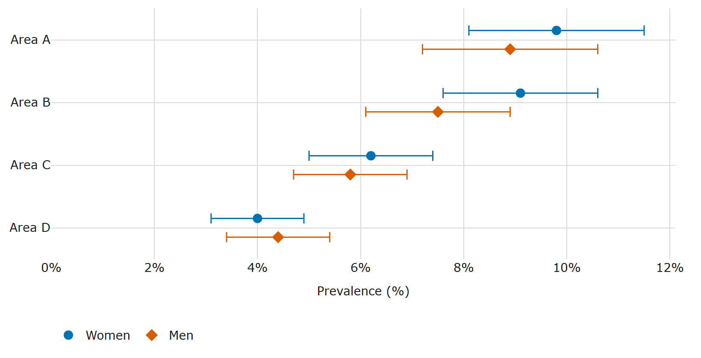
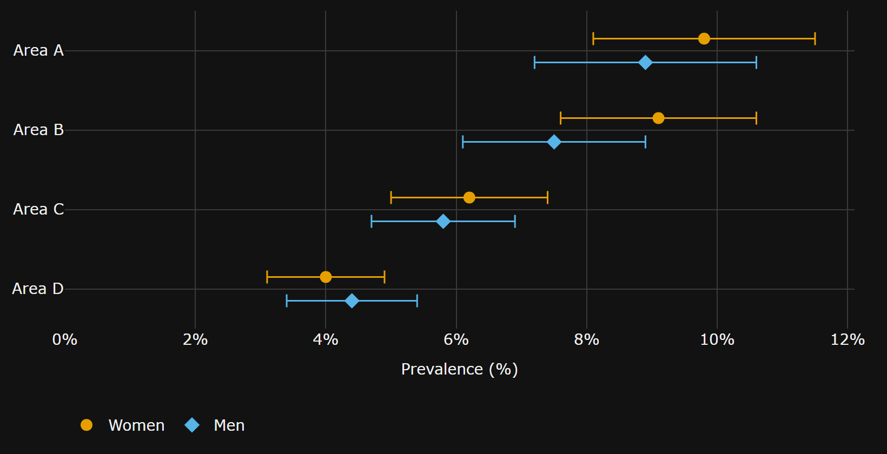

# disability-access-charts

**Charts that check their own words.**

Built for [Curb Cut](https://github.com/batestguy/curb-cut), an accessible platform for Nigerian disability data. Every chart ships with alt-text (the text alternative that WCAG 2.2 Success Criterion (SC) 1.1.1 asks for; W3C, 2023) built from its data, and the library then **checks that text against the data**: every number, and every comparison it recognises ("highest", "higher than", "twice", "ranked 3rd"). We call this the **claim checker**. With survey estimates, it tests whether the confidence intervals support the claim. The same checker gates any LLM rewording, and `audit()` runs it in CI on the library's own chart documents and, on a best-effort basis, on plain Plotly bar and scatter figures given their alt-text.

**Status: 0.4 (alpha).** English, plus Hausa, Yoruba, Igbo and Nigerian Pidgin (Naijá) **drafted by an AI model and not reviewed by a native speaker** (see "New in 0.4"). The library has not yet been evaluated with screen-reader users (see "Limitations" below).

## How it compares

Other tools make charts explorable; this one checks what a chart's description *claims*. In a search of PyPI, GitHub and the literature (2026-10-21) we found no other library that checks the comparative claims in a chart description against the chart's data. The closest work we found is AggChecker (Jo et al., 2019), a research system that checks natural-language claims about aggregates against a relational database rather than a chart.

| Tool | Language | What it does for access | Checks a description's claims against the data? |
|---|---|---|---|
| **disability-access-charts** | Python | A chart document with a description written from the data, a data table, light and dark themes and a WCAG-tagged audit; statistical findings with false-discovery-rate control | **Yes**: every number, and comparisons such as "higher than" or "highest", tested against the confidence intervals |
| [maidr](https://pypi.org/project/maidr/) (Seo et al., 2024) | Python (also R and JavaScript) | Charts explorable by keyboard, with sound, braille and text | Not described in the documentation we checked |
| [Olli](https://mitvis.github.io/olli/) (Blanco et al., 2022) | JavaScript | Turns a chart into a keyboard-navigable tree of text descriptions for screen readers, through adapters for charting toolkits | Not described in the documentation we checked |
| [a11yviz](https://pypi.org/project/a11yviz/) | Python | WCAG-tagged palettes, alt-text scaffolds and audits for plotnine, plotly and Quarto | Not described in the documentation we checked |
| Highcharts accessibility module | JavaScript | Keyboard navigation and ARIA markup; exposes the title, axis titles, series names and an author-written description | No generated summaries described on the page we checked |

Use maidr or Olli for exploring a chart by keyboard, sound or braille. Use this library to catch numbers and comparisons in a description (written by a person, a template or an LLM) that contradict the data, and to report which differences survive a multiple-comparison correction. They are complementary rather than alternatives. Sources and dates: a11yviz 0.1.8 and maidr 1.28.1 from their PyPI pages (2026-10-29); the Highcharts accessibility-module documentation (2026-11-04); Olli from its project pages (2026-11-08). No benchmark comparison with these tools has been run.

## New in 0.4: descriptions in Hausa, Yoruba, Igbo and Pidgin

- **Four more language tables** (`ha`, `yo`, `ig`, `pcm`): the description templates, the findings sentences, the map's own sentences and each language's claim-checker vocabulary, with the same keys and placeholders as English. Numbers stay as digits with "." as the decimal point. **The wording was drafted by an AI model (Claude) and has not been reviewed by a native speaker**; say so wherever you show it. Details, choices and limits: [the languages note](https://github.com/batestguy/curb-cut/blob/main/packages/disability-access-charts/docs/languages.md).
- **`translations=`** on `bar`, `grouped_bar`, `dot` and `choropleth`: a `Translation` per language carries the strings you supply (title, source, category label, interval label, and any names to translate). The document gains `alt_text_translations`: each language's description (and finding sentences, and a map's class sentence), from templates only, with `origin: "template"` and `reviewed: false`. No language model is involved.
- **Each translation is audited by its own language's claim checker**, and must have exactly the English description's numbers, in the same order; a template translation must equal what the templates give. A wrong number in a translation fails the audit.
- **Schema 1.1** for chart documents and **1.2** for choropleths: only the optional `alt_text_translations` field is new; documents without translations are unchanged apart from the version numbers.

## New in 0.3: maps that are easier to read

- **A clearer default map scheme.** `choropleth(scheme="ylgnbu")`, now the default: a yellow to green to blue scale chosen to stay distinguishable under simulated colour-vision deficiency (ColorBrewer's YlGnBu in the light theme (Harrower and Brewer, 2003), a matching dark palette that gets brighter with the value) with larger lightness steps than 0.2's greens. `MAP_SCHEMES` lists the schemes.
- **Cased boundaries.** No one boundary colour stands out from both a pale yellow and a dark blue, so a theme can add a `halo`: the page draws a wide halo stroke under a narrow edge stroke. The audit asks that the edge is 3:1 against the background and the halo, and that the edge or the halo is 3:1 against the background and every fill.
- **Map patterns ordered by ink weight**, lowest class lightest: plain, dots, lines, crosshatch, solid (`MAP_PATTERNS`; ordered subsets for fewer classes). **Each class has its own ink**, black or white, whichever contrasts more with its fill, audited at 3:1. Bars are unchanged.
- **A colour-vision check.** Neighbouring fills are compared under simulated deuteranopia, protanopia and tritanopia (Machado et al., 2009) with the CIEDE2000 colour difference (Luo et al., 2001; Sharma et al., 2005): an error under 5, a warning under 10. These are design thresholds chosen for this library, not WCAG numbers and not derived from a perception study. The default scheme's closest pair is 10.3 (light) and 11.6 (dark). Pure Python, in `disability_access_charts.vision`.
- **Legend-filter metadata.** Each class lists its regions and the sentence a page announces when a legend button shows only that class ("Showing 6 states in 4% to under 6%: …"), checked against the data.

What changed from 0.2, precisely:

- **Changed default:** `choropleth()` uses `scheme="ylgnbu"` (and `MAP_THEMES` is now its themes). For the 0.2 look, pass `scheme="green"`: the 0.2 greens, one boundary colour, the 0.2 pattern order and one ink per theme. Its audit now adds a `colour-vision-target` warning (the greens reach 7.5 and 8.2), so `check --strict` fails on it. **Custom themes too:** `choropleth(..., themes=...)` without `scheme` now gets the 0.3 pattern style (ink-weight order with an ink per class, no single `patterns.ink`) and the new audit checks, so a custom set of fills can fail the new `colour-vision` error (or the casing rule, if a theme has a halo); pass `scheme="green"` with your `themes=` to keep the 0.2 pattern order and one ink per theme.
- Map documents use schema `"1.1"`: `themes` may have a `halo`, `patterns` has `sequence` and (outside the green scheme) `class_ink` in place of `ink`, classes have `regions` and `announce`, and there are `legend`, `keyboard.legend_filter` and `meta.scheme`. `legend_filter=False` leaves the legend metadata out.
- New audit checks: cased-boundary contrast, `colour-vision`, `colour-vision-target`, `legend-filter-matches-data`, and `patterns-ink-rule` for maps.
- `svg_pattern()` takes `ink=None` for a tile with no ink. Bars, dot plots and everything else are unchanged apart from the version number.

See [the maps note](https://github.com/batestguy/curb-cut/blob/main/packages/disability-access-charts/docs/maps.md) and [the patterns note](https://github.com/batestguy/curb-cut/blob/main/packages/disability-access-charts/docs/patterns.md).

## New in 0.2

- **Statistical findings.** `findings=True` on `bar()`, `grouped_bar()` or `dot()` adds a block that compares the estimates in four families declared in advance (highest and lowest against the next, gaps between series, neighbours in the ranking, each estimate against an overall value), counts every comparison, and controls the false discovery rate (FDR) with the Benjamini-Hochberg procedure at q = 0.05 (Benjamini and Hochberg, 1995). It prints "N comparisons checked, K supported", hedges findings that involve an estimate flagged for review, and leaves out (and counts) those that involve a suppressed or unreliable one. The sentences go through the claim checker, and the audit recomputes the block from the data. It is descriptive, not causal: see [the findings method](https://github.com/batestguy/curb-cut/blob/main/packages/disability-access-charts/docs/findings.md).
- **Patterns.** Five abstract tiles inspired by adire (dots and rings after *oniko*, checks, lines, crosshatch), drawn for this library; never nsibidi or Ukara signs. `grouped_bar()` (new) gives each series its own colour and pattern, shown in the legend; `bar(patterns=True)` and every map class get one too. The audit checks that patterns and colours line up one to one and that the pattern ink is 3:1 against every fill in both themes. See [the patterns note](https://github.com/batestguy/curb-cut/blob/main/packages/disability-access-charts/docs/patterns.md).
- **Maps are stable.** `choropleth()` is exported, with a pattern per class by default, so neighbouring classes differ by more than a shade.
- **Precision flags.** `Series(..., precision=...)` takes a flag per estimate (`reliable`, `review`, `unreliable`, `suppressed`), shown in the table and used by the findings.

What changed from 0.1, precisely:

- `choropleth()` gives each class a pattern by default (`patterns=None` means "auto": on with five classes or fewer, off with more, when the audit warns that neighbouring classes differ by shade alone). `patterns=False` gives the 0.1 document; `patterns=True` with more than five classes raises.
- `describe(chart_type="bar")` with several series now describes grouped bars; in 0.1 it raised.
- In the claim checker, a list of names with values separated by semicolons ("A, 1%; B, 2%; and C, 3%") is one clause, so each estimate in a list written that way (with "; and" before the last item) is checked (a two-item list without the "and", or a comma list, is only partly checked), and a hedged rank ("the second-highest estimate") no longer warns when the test cannot separate it from a neighbour.

Otherwise `bar()` and `dot()` with patterns and findings off (their default) give the same document as in 0.1, apart from the version number.

```bash
pip install disability-access-charts            # core: no dependencies
pip install "disability-access-charts[plotly]"  # adds Plotly Figure support
```

## What it looks like

Every chart comes in a light and a dark theme, both contrast-checked:





The description the library wrote for this chart (synthetic data), shortened here:

> Women: highest estimate Area A, 9.8%, and the survey cannot show a difference from the next estimate, Area B, 9.1%; lowest estimate Area D, 4.0%, and the survey can show a difference from the next estimate, Area C, 6.2%. …

So "Area A is the highest" is never written, and if someone writes it, the checker rejects it:

```python
from disability_access_charts import ChartData, Series, check_alt_text, dot

areas = ["Area A", "Area B", "Area D"]
women = Series(
    "Women",
    values=(9.8, 9.1, 4.0),
    lower=(8.1, 7.6, 3.1),  # 95% confidence interval
    upper=(11.5, 10.6, 4.9),
)

doc = dot(
    areas,
    [women],
    title="ILLUSTRATIVE ONLY: synthetic prevalence (not real data)",
    value_label="Prevalence (%)",
    category_label="Area",
    source="Synthetic",
    unit="percent",
)
data = ChartData.from_dict(doc["data"])

check_alt_text("Area A is higher than Area D.", data)  # [] : the difference is supported
check_alt_text("Area A is higher than Area B.", data)
# [Problem(..., kind='comparison', severity='error',
#   reason='the survey cannot show that Area A is higher than Area B: the difference 0.70
#           is not more than 2.27', suggestion='the survey cannot show a difference')]
```

## What you get

`bar()`, `grouped_bar()`, `dot()` and `choropleth()` return one JSON document per chart, with no Plotly import needed:

| key | what it holds |
|---|---|
| `plotly` | a static Plotly.js spec: no hover-only data, no zoom or pan |
| `alt_text` | the description, built from the data, summary first |
| `table` | the same numbers as an accessible table |
| `data` | the numbers the checker reads (categories, series, intervals) |
| `themes` | light and dark colours, contrast-checked (WCAG 2.2 SC 1.4.3: text at least 4.5:1; SC 1.4.11: graphical objects at least 3:1) |
| `keyboard` | how a keyboard user reaches the data (the table) |
| `audit` | every check, each with a WCAG criterion and a severity |
| `meta` | generator, library version, source, alt-text language and origin |
| `findings` | with `findings=True`: the comparisons, their tests, the FDR result and the sentences |
| `patterns` | with patterns on: the tiles, each series' or class's tile, and the ink (each theme's, or since 0.3 each map class's) |
| `alt_text_translations` | with `translations=` (0.4): each language's description, origin, review status, inputs, finding sentences and (maps) class sentence |

Also: `audit(fig)` for a document or any Plotly figure, `theme(fig, "dark")`, `to_html(doc)` and `to_csv(doc)`, `figure(doc)` for a Plotly `Figure`, and a CLI for CI:

```bash
disability-access-charts check charts/*.json            # exit 1 if any chart fails
disability-access-charts check --strict charts/*.json   # warnings fail too
```

## What the checker checks

- **Numbers:** each must be a figure of the category it sits next to (value, interval bound or share), so "Kano, 11.9%" fails if 11.9% is Lagos's.
- **Extremes:** largest, highest, smallest, lowest.
- **Comparisons:** higher, lower, more, fewer than, including lists ("higher than Lagos and Abuja").
- **Ratios:** twice, half, N times, within 5%.
- **Ranks:** "ranked 2 of 37", "3rd", "the second-highest".
- **"No difference"** always fails: a survey can't show that two groups are equal.

**With confidence intervals**, "A is higher than B" passes only if the difference is larger than 1.96 times its standard error, worked out from the two intervals (a two-sided z-test at the 5% level). This assumes roughly symmetric intervals and independent groups, and applies **no correction for multiple comparisons**; it warns when groups may not be independent. "A is the highest" must be separated from every other group; otherwise write "A has the highest estimate".

**What a pass means:** no recognised claim was found false. It does not make a description true or complete.

**Limits.** Negated claims ("not higher"), words it doesn't know ("exceeds", "similar"), and numbers written as words get a warning, not a check. Differences written as numbers ("3 points higher"), comparisons with a stated number ("above 10%"), trends and causes are not understood. The full rules are in [the claim checker reference](https://github.com/batestguy/curb-cut/blob/main/packages/disability-access-charts/docs/claim-checker.md).

## LLM polish (optional)

`polish_alt_text(doc, disclosure_checked=True)` asks Gemini, then Groq, to reword the alt-text. A rewording is kept only if the checker finds no errors or warnings in it and it keeps every category, number, interval label and the source; otherwise the data-built text stays. It sends only the chart's aggregates, title and source. **Pass only disclosure-checked public aggregates, never microdata.** Results are cached in `.disability_access_charts_cache/`, and the tests never call the network.

## More

- **Languages:** one table of templates and claim words per language (`_lang/en.py`, `ha.py`, `yo.py`, `ig.py`, `pcm.py`; `LANGUAGES`). The four Nigerian-language tables are AI-drafted and unreviewed. Numbers stay as digits in every language, so the checker still works. eSpeak NG (which NVDA uses) has no voice for Hausa, Yoruba, Igbo or Pidgin, so these descriptions serve readers rather than listeners.
- **Maps:** `choropleth()` builds a shaded-map document in fixed classes, each with its own pattern (up to five classes, ordered by ink weight) on a scale chosen to stay distinguishable under simulated colour-vision deficiency, with cased boundaries, with the same alt-text checks, a table and an audit; `audit()` and `check` handle it. The page draws the SVG from the document. How its colours and patterns meet WCAG is in [the maps note](https://github.com/batestguy/curb-cut/blob/main/packages/disability-access-charts/docs/maps.md).
- **Python:** 3.10 or later. Tests and CI run on 3.12 only. Python 3.10 was checked by hand for the 0.2.0 release (installing the wheel and running the examples); it is not part of CI.
- **Examples** (in the source distribution and the repository's `examples/`): JONAPWD's 2025 *assumed* figures by disability type (a WHO 15% benchmark applied to population, not survey estimates), a synthetic dot plot with intervals and findings, a synthetic patterned map written out as a standalone SVG page, and an audit of a plain Plotly figure. The installed package holds no data.

## Limitations

- **No evaluation with screen-reader users yet.** The generated wording follows a published interview study (Sharif et al., 2023), but the library's own output has not been tested with regular screen-reader users. The author is not a screen-reader user.
- **Automated checks are partial.** The audit checks the chart document (colours, alt-text, table, metadata). It cannot check how a page renders the document, how a screen reader announces it, or whether a description is useful; those need manual testing.
- **The claim checker has known blind spots** (listed above and in [the claim checker reference](https://github.com/batestguy/curb-cut/blob/main/packages/disability-access-charts/docs/claim-checker.md)); its false-negative rate on real descriptions has not been measured.
- **Colour-vision thresholds are design choices**, not validated against perception data (see [the maps note](https://github.com/batestguy/curb-cut/blob/main/packages/disability-access-charts/docs/maps.md)).

## References

Benjamini, Y. and Hochberg, Y. (1995). Controlling the false discovery rate: a practical and powerful approach to multiple testing. *Journal of the Royal Statistical Society, Series B*, 57(1), 289–300. https://doi.org/10.1111/j.2517-6161.1995.tb02031.x

Harrower, M. and Brewer, C. A. (2003). ColorBrewer.org: an online tool for selecting colour schemes for maps. *The Cartographic Journal*, 40(1), 27–37. https://doi.org/10.1179/000870403235002042

Jo, S., Trummer, I., Yu, W., Wang, X., Yu, C., Liu, D. and Mehta, N. (2019). AggChecker: a fact-checking system for text summaries of relational data sets. *Proceedings of the VLDB Endowment*, 12(12), 1938–1941. https://doi.org/10.14778/3352063.3352104

Luo, M. R., Cui, G. and Rigg, B. (2001). The development of the CIE 2000 colour-difference formula: CIEDE2000. *Color Research and Application*, 26(5), 340–350. https://doi.org/10.1002/col.1049

Machado, G. M., Oliveira, M. M. and Fernandes, L. A. F. (2009). A physiologically-based model for simulation of color vision deficiency. *IEEE Transactions on Visualization and Computer Graphics*, 15(6), 1291–1298. https://doi.org/10.1109/TVCG.2009.113

Blanco, M., Zong, J. and Satyanarayan, A. (2022). Olli: an extensible visualization library for screen reader accessibility. *IEEE VIS 2022 Posters*. https://vis.mit.edu/pubs/olli

Seo, J., Xia, Y., Lee, B., McCurry, S. and Yam, Y. J. (2024). MAIDR: making statistical visualizations accessible with multimodal data representation. In *Proceedings of the CHI Conference on Human Factors in Computing Systems*. https://doi.org/10.1145/3613904.3642730

Sharif, A., Zhong, R. and Wang, Y. (2023). Conveying uncertainty in data visualizations to screen-reader users through non-visual means. In *Proceedings of the 25th International ACM SIGACCESS Conference on Computers and Accessibility (ASSETS '23)*. https://doi.org/10.1145/3597638.3614502

Sharma, G., Wu, W. and Dalal, E. N. (2005). The CIEDE2000 color-difference formula: implementation notes, supplementary test data, and mathematical observations. *Color Research and Application*, 30(1), 21–30. https://doi.org/10.1002/col.20070

W3C (2023). *Web Content Accessibility Guidelines (WCAG) 2.2*. W3C Recommendation. https://www.w3.org/TR/WCAG22/

MIT licensed.
